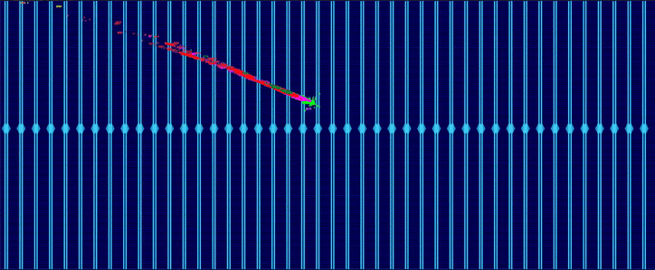

# Borg - Tiny Open Source Graphics Processing Unit


[](https://doi.org/10.5281/zenodo.21189252)

## Foundational workflow for an open-source GPU

The Borg (**B**ring yer **O**wn **GR**aphics) project—supported by [NLnet](https://nlnet.nl/project/Borg)—is
establishing a fully transparent, end-to-end silicon implementation flow for open-source GPU hardware using
a 100% libre EDA toolchain.
Recognizing that full GPU development is highly complex, the initiative capitalizes on recent
advances in low-cost chip manufacturing to make individual tape-outs feasible for small teams.

📖 Read the [Borg GPU Book](https://gonsolo.github.io/Borg/) for detailed documentation.


### ASIC Global Placement Evolution



*100-frame placement animation from the OpenROAD EDA toolchain. Colors indicate functional Chisel modules.*
<!-- markdownlint-restore MD033 -->

## Architecture

The design is a **Hutt RISC-V SoC** with the **Borg shader processor** (FP32 by default, FP16 selectable) as a memory-mapped peripheral,
targeting ECP5 FPGAs (ULX3S) and an ASIC (GF180MCU via wafer.space, Borg only behind a chip-to-chip link).

### Borg Shader Processor

A small programmable shading unit with:

- **A RISC-V-based instruction set** (ISA v2) — a subset of RV32I with Zfinx, Zmmul, parts of Zbb and Zicond in standard encodings, plus GPU instructions (texture sampling, derivatives, varyings)
- **Fused Multiply-Add (FMA)** — in-tree IEEE-754 unit, FP32 by default, FP16 selectable
- **2×2 quad SIMT** — 4 lanes in lockstep (derivatives across the quad), 32 registers per lane, and 4 quad slots in flight to hide latency
- **An in-order pipeline** with scoreboard interlocks
- **Programs in memory** — fetched through a direct-mapped instruction cache, so a shader is limited by memory, not by an instruction RAM
- **Hardware reciprocal, reciprocal square root and sRGB encode** — LUT + linear interpolation (FRCP, FRSQ, FSRGB)
- **Hardware Tile Buffer** — 4×4-pixel tiles with depth, stencil and 4× MSAA
- **Descriptor-based texture unit** — 51 formats, sizes up to 4096, mipmaps, all address modes and border colours, trilinear filtering, depth compare, gather and texel fetch
- **Compute shaders** — workgroups, shared memory, barriers and atomics

### Rendering Pipeline

Draws run in hardware, started from render lists in memory that the Vulkan driver builds while
recording a command buffer:

1. **Primitive assembly** — lists, strips, fans, indexed draws, primitive restart and instancing
2. **Vertex shader** — one run per triangle, its three corners on three SIMT lanes; it fetches its attributes from the application's vertex buffers itself
3. **Setup** — 2D homogeneous triangle setup in a ROM program, so no clipping is needed
4. **Tile binning and rasterization** — triangles sorted into 4×4-pixel tiles, perspective-correct barycentrics
5. **Fragment shader** — on 2×2 quads, with depth and stencil tests, blending, occlusion queries and 4× MSAA
6. **Tile flush** — finished tiles written to the attachments in device memory, in every Vulkan colour format

### SPIR-B Shader Format

**borgc**, Borg's shader compiler, turns Vulkan SPIR-V through Mesa's NIR into Borg machine code in a compact
binary format (SPIR-B); the driver compiles every pipeline at creation.

### SystemRDL & Hardware Command FIFO

The MMIO architecture is generated automatically via the Accellera **SystemRDL** standard using `PeakRDL-chisel`, emitting both the Chisel `BorgGpuRegs` layout and the C-headers directly.

It features an asynchronous 2-entry **Command FIFO** so the CPU can queue commands while the GPU works in the background.

### Software

- **borgvk** — a native Vulkan driver in Mesa, written in Rust (modeled on v3dv), targeting Vulkan 1.0. Device memory is used in place, and render passes become render lists while the command buffer is recorded. It runs the unmodified Khronos `vkcube`.
- **The direct simulator** — Borg alone, cycle-accurate, compiled from the same Chisel by Arcilator (or Verilator); the Vulkan CTS runs on it.
- **A Linux DRM driver** — a render-only DRM driver in Rust exposes Borg as a render node, through which borgvk drives the GPU.

### Hutt CPU

A clean multi-cycle **RV32I/RV64I** RISC-V core written in Chisel with fully **Decoupled** instruction and data buses, parameterized by XLEN. The QSPI SoC used for the cocotb SoC tests and the ULX3S target with Borg use RV32I; RV64IMAC with M-mode/S-mode privilege levels and an Sv39 MMU runs on the MinimalSoC harness, which boots Linux. Hutt integrates seamlessly with the `MemoryController` (arbitrating QSPI flash and SDRAM) and routes MMIO via `SoCDecode` to inline SoC registers, the user peripheral router, and the Borg peripheral bus. Verified on ULX3S hardware.

**Linux boots on Hutt.** OpenSBI + a mainline Linux kernel (device-tree only, no config patches) boot to an interactive shell on real ULX3S hardware and in the cycle-accurate Verilator simulator, cross-validated at matching cycle counts. On 2026-10-06 the unmodified `cube.c` ran on Linux on Hutt through Mesa and the Rust DRM driver, self-hosted on the board; with the FP32 Borg, RV64 no longer fits on the ECP5 next to it, so that mode returns on a larger FPGA (see [The Hutt CPU](docs/A3_hutt_cpu.md), [The FPGA](docs/04_fpga.md) and [Test and demo modes](docs/B14_test_modes.md)).

## Prerequisites

- [Nix](https://nixos.org)
- [Git](https://git-scm.com)
- [Make](https://www.gnu.org/software/make)

## Building and Testing

### Run all tests (Chisel, cocotb, borgvk, the vkcube golden)

```bash
make test-all
```

### Individual test targets

```bash
make test-chisel-borg          # Borg FPU unit tests (Chisel)
make test-chisel-core          # Hutt CPU tests (Chisel)
make test-cocotb-soc-core-rtl  # CPU SoC integration tests (cocotb)
make test-cocotb-soc-borg-rtl  # Borg peripheral tests (cocotb)
```

### Vulkan Conformance (CTS)

dEQP-VK runs against borgvk on the direct simulator (Borg alone, no CPU):

```bash
make -C simulation/direct                                  # the simulator
JOBS=12 scripts/cts_par.sh 'dEQP-VK.api.device_init.*'     # a case or pattern, in parallel
```

The build steps for `deqp-vk` are in [The Software Driver](docs/03_software_driver.md).

### vkcube on the simulated GPU

The unmodified Khronos `vkcube` on borgvk and the cycle-accurate model, in an X window
(`DIRECT_BIN=simulation/direct/direct_sim_v` for the Verilator model):

```bash
make build-vkcube && make -C simulation/direct
scripts/vkcube_host.sh
```

### FPGA (ULX3S — ECP5)

Prerequisites: ULX3S board.

```bash
cd fpga/ulx3s
make load           # Synth + P&R + load to SRAM
make flash          # Write to config flash
make tio            # Open serial console on /dev/ttyUSB0
```

### ASIC (wafer.space)

```bash
make librelane      # GF180MCU 1x1 slot: full RTL-to-GDS signoff via LibreLane
```

See [Generating the ASIC](docs/05_asic.md).

## Generative AI use

Parts of Borg are developed with an AI coding assistant (Claude Code; model and
version are recorded per commit), mainly for the Vulkan driver and shader compiler,
hardware debugging, test scaffolding and documentation. Every change on `main` is reviewed and tested by
a human, declares its AI use in commit trailers (`AI-Assisted`, `AI-Prompts`,
`Reviewed-by`), and generated code is checked for copied material. Experiments
stay on local branches. Generated Verilog, register blocks and compiler output
are deterministic tool output, not GenAI. Details and enforcement:
[docs/ai_policy.md](docs/ai_policy.md).

## Milestones

| Milestone | Status |
| --- | --- |
| FPU integrated into Hutt SoC | ✅ Done |
| Vertex shader on FPGA | ✅ Done |
| Triangle rasterization + fragment shading | ✅ Done |
| SPIR-B runtime shader loading | ✅ Done |
| Per-vertex color interpolation | ✅ Done |
| Hardware Tile Buffer (Z-Buffer depth test) | ✅ Done |
| Descriptor-based texture unit (51 formats, mipmaps) | ✅ Done |
| 32-bit RISC-V instructions & 32-entry register file | ✅ Done |
| Hardware perspective projection (4×4 MVP shader) | ✅ Done |
| Hardware reciprocal (FRCP) | ✅ Done |
| Cycle-accurate C++ simulation (Arcilator & Verilator) | ✅ Done |
| Hardware draw front end (primitive assembly, homogeneous setup) | ✅ Done |
| 4× MSAA | ✅ Done |
| Compute shaders | ✅ Done |
| Shader compiler (borgc, SPIR-V via NIR) | ✅ Done |
| Unmodified Khronos vkcube through borgvk (simulator and ULX3S) | ✅ Done |
| Linux boot on Hutt (RV64 + Sv39 MMU, ULX3S + Verilator) | ✅ Done |
| Linux DRM kernel driver for Borg (render node, in Rust) | ✅ Done |
| Vulkan 1.0 conformance (borgvk on the direct simulator) | 🚧 In progress |
| Display output through DRM/KMS | ⏳ Pending |
| Test manufactured chip | ⏳ Pending |

## Software Bill of Materials

| Component | Description | License |
| --- | --- | --- |
| [Chisel](https://github.com/chipsalliance/chisel) | Hardware construction language (Scala → Verilog) | Apache-2.0 |
| Hutt | RV32I/RV64I RISC-V CPU core (multi-cycle, Chisel, Decoupled buses) | CERN-OHL-S-2.0 |
| [LibreLane](https://github.com/efabless/librelane) | RTL-to-GDS ASIC flow orchestrator | Apache-2.0 |
| [Yosys](https://github.com/YosysHQ/yosys) | RTL synthesis | ISC |
| [OpenROAD](https://github.com/The-OpenROAD-Project/OpenROAD) | Place and route | BSD-3-Clause |
| [Magic](https://github.com/RTimothyEdwards/magic) | Layout tool, DRC, GDS export | MIT |
| [KLayout](https://github.com/KLayout/klayout) | GDS viewer and DRC | GPL-2.0 |
| [GF180MCU PDK](https://github.com/google/gf180mcu-pdk) | GlobalFoundries 180nm process design kit | Apache-2.0 |
| [cocotb](https://github.com/cocotb/cocotb) | Python-based RTL simulation and testing | BSD-3-Clause |
| [Icarus Verilog](https://github.com/steveicarus/iverilog) | Verilog simulation (cocotb backend) | GPL-2.0 |
| [Verilator](https://github.com/verilator/verilator) | Verilog linting and simulation | LGPL-3.0 |
| [nextpnr](https://github.com/YosysHQ/nextpnr) | FPGA place and route (ECP5) | ISC |
| [Project Trellis](https://github.com/YosysHQ/prjtrellis) | ECP5 FPGA bitstream tools | ISC |
| [Netgen](https://github.com/RTimothyEdwards/netgen) | LVS (Layout vs. Schematic) | MIT |
| [GCC](https://gcc.gnu.org/) | RISC-V cross-compiler (OpenSBI, Linux) | GPL-3.0 |
| [Mesa](https://gitlab.freedesktop.org/mesa/mesa) | Vulkan runtime, NIR; home of borgvk and borgc | MIT |
| [Rust](https://www.rust-lang.org/) | Language of borgvk, borgc and the DRM driver | MIT / Apache-2.0 |
| [Linux](https://kernel.org/) | Kernel on Hutt and the Borg DRM driver | GPL-2.0 |
| [OpenSBI](https://github.com/riscv-software-src/opensbi) | RISC-V supervisor binary interface firmware | BSD-2-Clause |
| [Vulkan-Tools](https://github.com/KhronosGroup/Vulkan-Tools) | The unmodified `vkcube` | Apache-2.0 |
| [VK-GL-CTS](https://github.com/KhronosGroup/VK-GL-CTS) | Vulkan conformance tests | Apache-2.0 |
| [Mill](https://github.com/com-lihaoyi/mill) | Scala build tool | MIT |
| [Nix](https://github.com/NixOS/nix) | Reproducible development environment | LGPL-2.1 |
| [CIRCT/firtool](https://github.com/llvm/circt) | Chisel → Verilog compiler (FIRRTL) | Apache-2.0 (LLVM) |
| [Arcilator](https://github.com/llvm/circt) | Cycle-accurate FIRRTL C++ simulator | Apache-2.0 (LLVM) |
| [OpenJDK](https://openjdk.org/) | Java runtime for Chisel/Mill | GPL-2.0 + CE |
| [SystemRDL](https://www.accellera.org/downloads/standards/systemrdl) | Register logic definition standard | Accellera |
| [PeakRDL](https://github.com/SystemRDL/PeakRDL) | Toolchain for parsing and exporting SystemRDL | GPL-3.0 |

## Citation

If you use the Borg GPU in your research or project, please cite the HPG 2026 poster:

```bibtex
@misc{Wendleder_Borg_2026,
  author    = {Wendleder, Andreas},
  title     = {{Borg (Bring yer Own GRaphics): An Open-Source Tile-Based GPU with Silicon Tapeout}},
  howpublished = {Poster presented at High-Performance Graphics (HPG) 2026},
  month     = jul,
  year      = {2026},
  url       = {https://github.com/gonsolo/Borg},
}
```

Alternatively, see the [CITATION.cff](CITATION.cff) file for machine-readable citation information.
