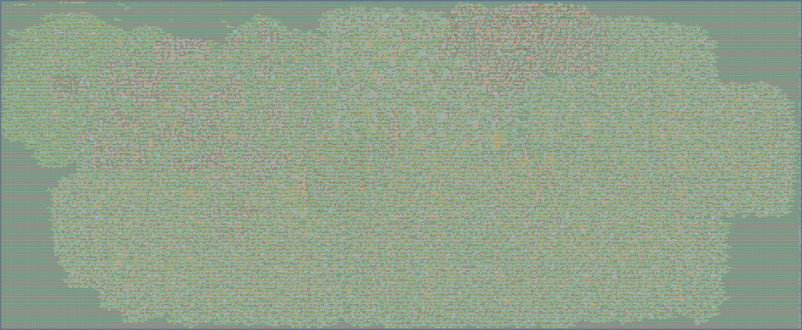

# Borg — An Open-Source GPU

<!-- markdownlint-disable MD033 -->
<p align="center">
  
</p>
<!-- markdownlint-enable MD033 -->

## Quick Start

```bash
# Clone and enter the reproducible toolchain:
git clone --recurse-submodules <repo>
cd Borg
nix develop          # or: direnv allow (if using direnv)

# Run all unit tests (~2 min):
make test-all

# Cycle-accurate simulation:
make build-vkcube && make -C simulation/direct
scripts/vkcube_host.sh                         # the unmodified vkcube on the simulated GPU
make -C simulation/direct golden               # its first frame, bit-exact

# Build and flash the ULX3S FPGA:
cd fpga/ulx3s && make load   # ~10 min first run; subsequent: ~3 min
```

## Known Issues / Limitations

- **Board demo**: the serial vkcube demo was removed (2026-11-04); vkcube on the
  ULX3S comes back through Linux and the DRM driver. 800×480 HDMI is wired, but
  the SDRAM bandwidth at 25 MHz limits the frame rate at that size.
- **Conformance**: the Vulkan CTS runs against the RTL on the direct simulator;
  the `api` group passes without failures, the full Vulkan 1.0 list does not yet.
  See [Vulkan 1.0 Conformance Status](conformance/STATUS.md).
- `BorgConfig.Default` (ULX3S) is the primary FPGA target.
- **Gate-level tests**: `make -C asic/wafer.space sim-link-synth` and
  `sim-link-gl` need a synthesis or post-layout netlist from LibreLane; they
  are not part of `make test-all`.

## Reading Order

The chapters are largely self-contained, but some paths work better than others
depending on your goal:

- **"I want to understand the architecture"** — Read [07_tbr](07_tbr.md) first
  (the two-pass TBR gives the big picture), then [01_shader_processor](01_shader_processor.md),
  then [03_software_driver](03_software_driver.md).
- **"I want to build or modify the hardware"** — Start with [CLAUDE.md](../CLAUDE.md)
  (build system) and [A0_roadmap](A0_roadmap.md) (where things stand), then
  dive into the relevant chapter.
- **"I want to understand the compiler"** — Read [02_compiler](02_compiler.md),
  which assumes familiarity with [01_shader_processor](01_shader_processor.md).
- **"I'm unfamiliar with the terminology"** — See the [Glossary](glossary.md)
  for canonical names (BorgCore, tile buffer, SPIR-B, etc.).

## Table of Contents

0. [Introduction](00_introduction.md) — Motivation and project overview
1. [The Borg Shader Processor](01_shader_processor.md) — FP32 quad core, registers, instruction cache, the ISA
2. [The Shader Compiler](02_compiler.md) — borgc: NIR to Borg machine code inside Mesa
3. [The Software Driver](03_software_driver.md) — borgvk, the Vulkan driver, and where it runs
4. [Running on an FPGA](04_fpga.md) — ULX3S FPGA target
5. [Generating the ASIC](05_asic.md) — RTL-to-GDS flow, configuration, verification
6. [Simulation](06_simulation.md) — Arcilator, Verilator, the direct simulator, the Linux boot harness
7. [Tile-Based Rendering](07_tbr.md) — Two-pass TBR, BorgBinner, BorgSequencer FSM, DRAM layout

### Appendices

**Hardware specifications**

- [Geometry Front End](B1_geometry_front_end.md) — Draws walked by hardware, homogeneous setup without clipping, perspective-correct varyings
- [Texture Unit](B2_texture_unit.md) — Descriptor-based TEX: any size to 4096, mipmaps, 51 formats, compare, gather, fetch
- [Colour Attachment Formats](B3_colour_formats.md) — RAW words the shader packs and blends through TLD: every Vulkan colour format up to 128 bits
- [ISA v2](B8_isa_v2.md) — The shader ISA as a RISC-V subset (RV32I, Zfinx, Zmmul, Zbb, Zicond) plus custom GPU ops
- [Pipeline](B9_pipeline.md) — An in-order pipeline with interlocks, then several quads in flight
- [Partial render](B11_partial_render.md) — Render what is binned when a bin fills, then continue
- [SPIR-B](spirb.md) — The shader binary format borgc writes and borgvk loads
- [The Hutt CPU](A3_hutt_cpu.md) — Multi-cycle RV32I/RV64I core with Decoupled buses

**Compiler and driver design**

- [borgc in SSA](B10_borgc_ssa.md) — Basic blocks and SSA in the compiler, exec masks and the linear CFG
- [borgc spilling](B12_borgc_spilling.md) — One legalization pass, an allocator that spills in one compile, spill stores in helper lanes
- [GPU Memory](B5_gpu_memory.md) — VkDeviceMemory through the DRM driver (GEM allocator in the Rust render node), and how to test it
- [Device memory, command lists and descriptors](B13_device_memory.md) — Device memory and images in place, render lists built while recording, descriptor sets in memory
- [ISA Gaps](B4_isa_gaps.md) — What shaders need and the ISA lacks: pow/log/exp, compares, constants; the sRGB idiom case
- [Compiler and Driver Contract](B0_compiler_contract.md) — What borgc and borgvk had to do for the Vulkan conformance hardware

**Testing and status**

- [Test and demo modes](B14_test_modes.md) — Where Mesa, the DRM driver, Linux and the GPU run: simulators, UML, QEMU, ULX3S, NiteFury II
- [Linux on Hutt on the Nexys Video](B15_nexys_linux.md) — Plan: RV64 Linux on the board with Borg, no host; phases L1 to L6, frame rate levers
- [Vulkan 1.0 Conformance Status](conformance/STATUS.md) — CTS results on the direct simulator per group, the `api` result and known limits

**Notes and history**

- [borgc design notes](B6_borgc_notes.md) — Why the Rust shader compiler does what it does
- [borgvk design notes](B7_borgvk_notes.md) — Why the Vulkan driver does what it does
- [Development Roadmap](A0_roadmap.md) — Phases, tile budget, hardware resources, as the project went
- [Gap Analysis and Vulkan Strategy](A2_gap_analysis.md) — The early plan: vkcube, SuperTuxKart, "No Graphics API", the Vulkan ICD
- [Experiments](A4_experiments.md) — Tried and measured: the nibble-serial FMA and others
- [Register Architecture](A5_register_architecture.md) — The FP16-era register and uniform storage design (April 2026)
- [Resource Audit](A6_resource_audit.md) — iCE40 UP5K resources, from before the ECP5
- [FPGA LC Savings](A7_lc_savings.md) — Where the ECP5 logic cells went (April 2026)
- [Architectural Tricks](A8_architectural_tricks.md) — 15 tricks for minimizing area

**Reference**

- [Glossary](glossary.md) — Canonical terminology for hardware components, shader formats, and tools
- [Bibliography](A1_bibliography.md) — References and further reading
- [Project Poster](A9_poster.md) — Academic poster summarizing the Borg GPU architecture
- [Generative AI policy](ai_policy.md) — How Borg follows NLnet's policy
